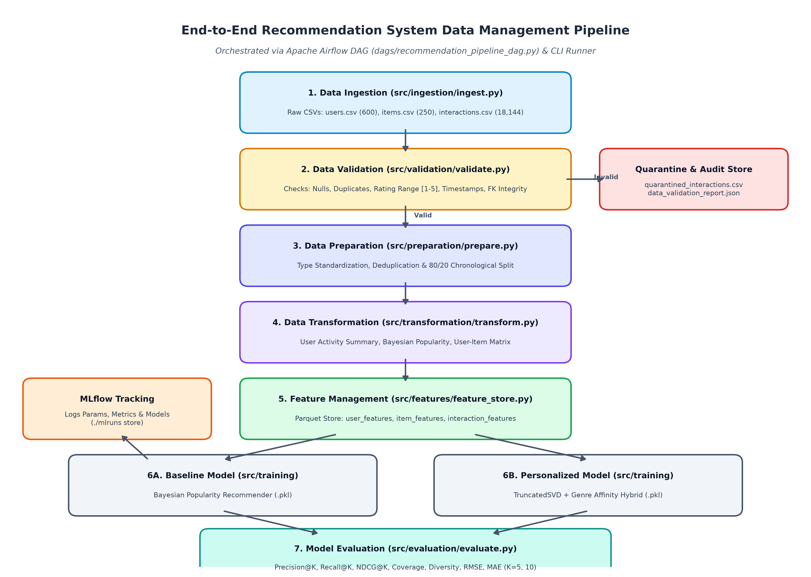
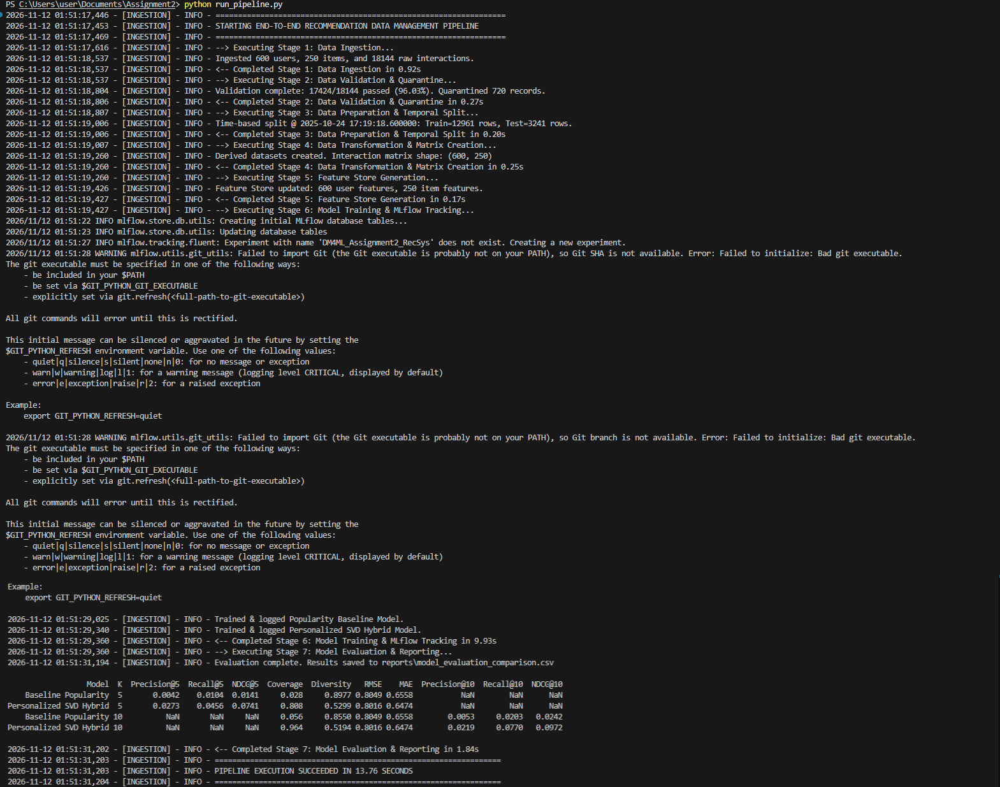
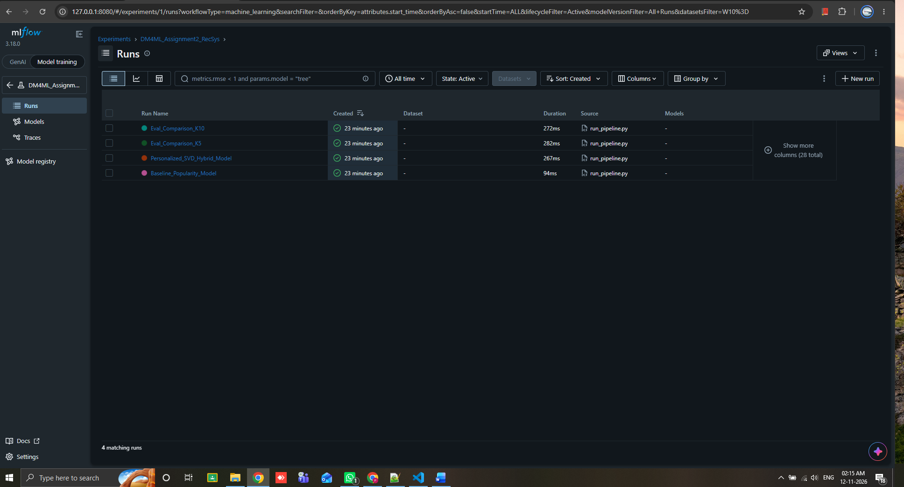
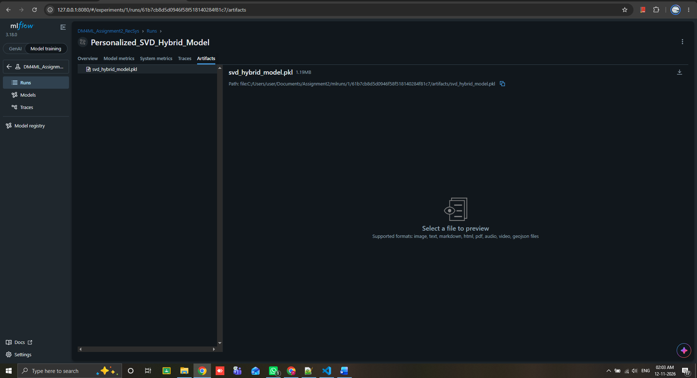

# End-to-End Data Management Pipeline for a Recommendation System

## 1. Overview
This repository implements an end-to-end, reproducible Data Management Pipeline for an online movie streaming recommendation platform (**CineStream**). It covers the complete lifecycle:
`Data Ingestion -> Data Validation -> Data Preparation -> Data Transformation -> Feature Management -> Model Training (MLflow) -> Model Evaluation -> Orchestration (Airflow)`.

---

## 2. Pipeline Architecture Diagram


---

## 3. Project Structure
```text
recommendation-pipeline/
├── configs/
│   └── config.yaml                    # Centralized pipeline parameters & paths
├── dags/
│   └── recommendation_pipeline_dag.py # Apache Airflow DAG definition
├── data/
│   ├── raw/                           # Ingested CSVs (users, items, interactions)
│   ├── processed/                     # Cleaned Parquet splits & interaction matrix
│   ├── features/                      # Reusable User, Item, and Interaction features
│   └── errors/                        # Quarantined records failing quality checks
├── models/                            # Serialized model artifacts (.pkl)
├── reports/                           # Validation JSON, Evaluation MD, Architecture PNG
├── src/
│   ├── ingestion/ingest.py            # Synthetic dataset & anomaly generator
│   ├── validation/validate.py         # Automated schema, range, temporal & FK checks
│   ├── preparation/prepare.py         # Deduplication & chronological train/test split
│   ├── transformation/transform.py    # Activity summaries, Bayesian pop, pivot matrix
│   ├── features/feature_store.py      # Feature engineering & Parquet feature store
│   ├── training/train.py              # Popularity Baseline & SVD Hybrid + MLflow
│   └── evaluation/evaluate.py         # Precision@K, Recall@K, NDCG@K, Coverage, Diversity, RMSE, MAE
├── requirements.txt
├── run_pipeline.py                    # Standalone deterministic pipeline orchestrator
└── README.md
```

---

## 4. Setup and Execution Instructions

### Step 1: Install Dependencies
```bash
pip install -r requirements.txt
pip install tabulate matplotlib
```

### Step 2: Run the End-to-End Pipeline
```bash
python run_pipeline.py
```
This single command executes all 7 stages sequentially, populates `data/`, `models/`, and `reports/`, and logs experiments to MLflow (`./mlruns`).

### Step 3: Generate the Architecture Diagram
```bash
python generate_diagram.py
```


### Step 4: View MLflow Experiment Tracking UI
```powershell
python -m mlflow ui --backend-store-uri sqlite:///mlflow.db --host 127.0.0.1 --port 8080
```
### 5. Feature Catalog
| Feature Name | Entity Level | Data Type | Source Table | Description & Logic |
| :--- | :--- | :--- | :--- | :--- |
| `activity_count` | User | `int64` | `user_features.parquet` | Total historical validated interactions per user. |
| `avg_rating` | User | `float64` | `user_features.parquet` | User's mean rating across training history. |
| `rating_std` | User | `float64` | `user_features.parquet` | Standard deviation of user's historical ratings. |
| `preferred_category` | User | `string` | `user_features.parquet` | Most frequently interacted movie genre for the user. |
| `days_since_last_interaction` | User | `int64` | `user_features.parquet` | Days elapsed since the user's last recorded interaction. |
| `interaction_count` | Item | `int64` | `item_features.parquet` | Total number of unique training users interacting with item. |
| `item_avg_rating` | Item | `float64` | `item_features.parquet` | Mean explicit rating received by the item. |
| `bayesian_popularity_score` | Item | `float64` | `item_features.parquet` | Bayesian damped rating (`m=10`) preventing small-sample bias. |
| `popularity_percentile` | Item | `float64` | `item_features.parquet` | Percentile rank (`0.0 - 1.0`) of item interaction volume. |
| `item_age_years` | Item | `int64` | `item_features.parquet` | Years elapsed since the item's `release_year`. |
| `category_affinity_match` | Interaction | `int64` | `interaction_features.parquet` | `1` if item genre matches user's `preferred_category`, else `0`. |
| `user_rating_bias` | Interaction | `float64` | `interaction_features.parquet` | User's rating offset relative to global mean rating. |


## 6. Pipeline Execution & MLflow Tracking Screenshots

### End-to-End Orchestration Run (`run_pipeline.py`)


### MLflow Experiment Runs & Metrics


### MLflow Logged Model Artifacts
