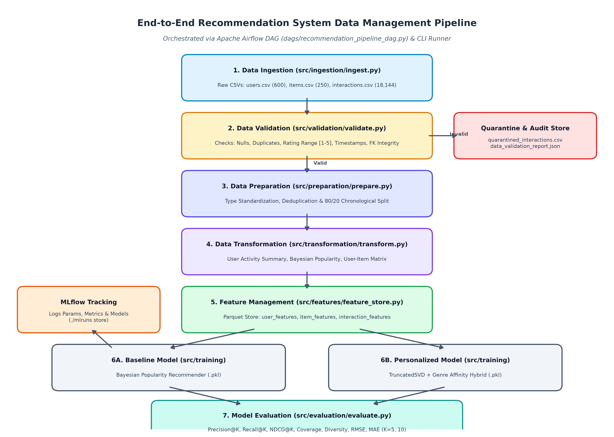
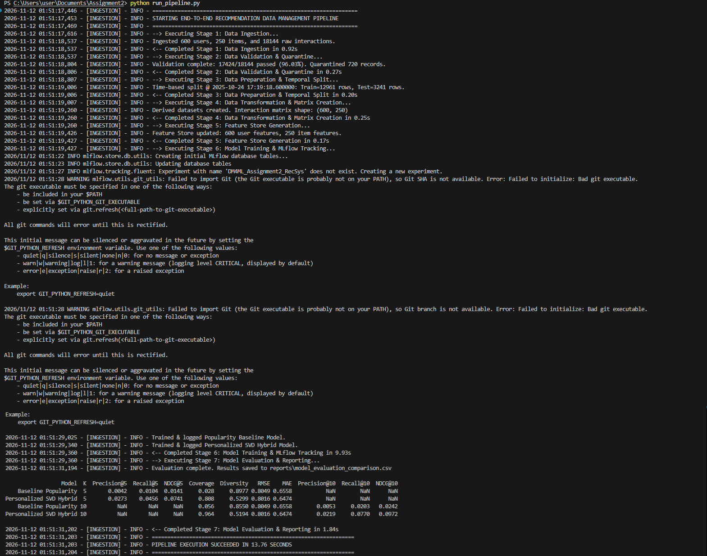
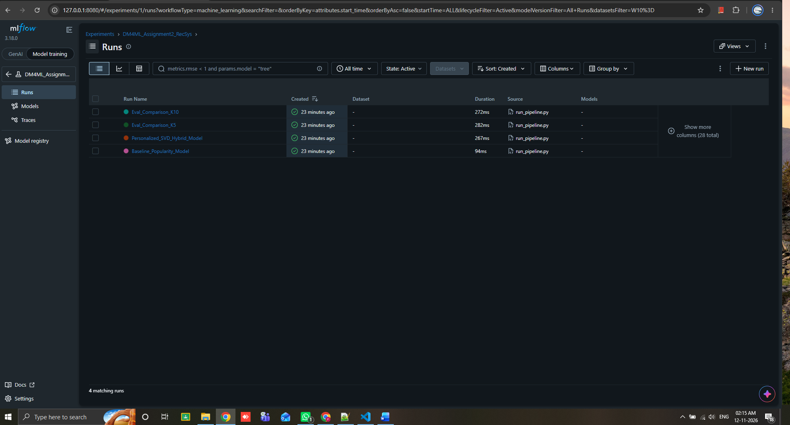
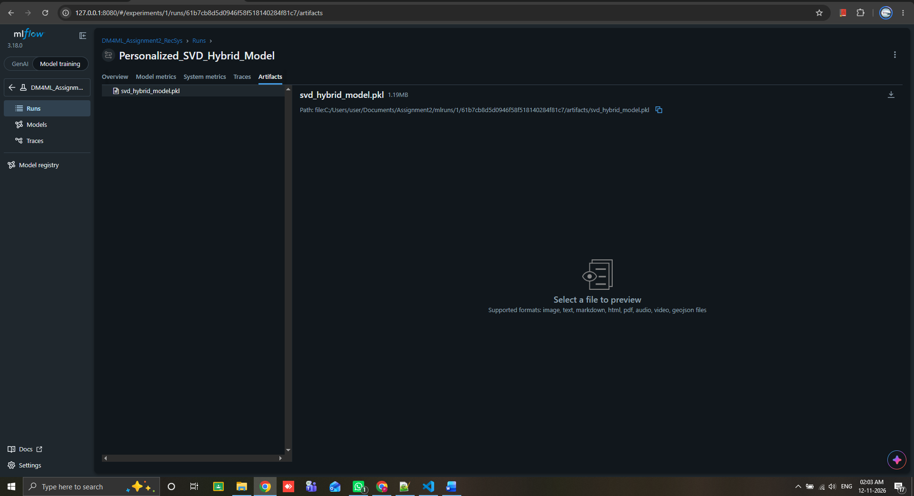

# Final Technical Report: End-to-End Data Management Pipeline for a Recommendation System
**Course:** Data Management for Machine Learning – Assignment 2  
**GitHub Repository Link:** [https://github.com/kira555-lang/dm4ml-assignment2-recsys](https://github.com/kira555-lang/dm4ml-assignment2-recsys)

---

## 1. Executive Summary & System Architecture
Production machine learning systems rely heavily on disciplined data engineering, automated data-quality validation, and reusable feature stores. In this assignment, we designed and implemented an end-to-end data management pipeline for **CineStream**, an online movie streaming recommendation platform. The pipeline is organized into seven modular stages orchestrated via an Apache Airflow DAG (`dags/recommendation_pipeline_dag.py`) and a deterministic Python workflow runner (`run_pipeline.py`):

1. **Data Ingestion (`src/ingestion/ingest.py`)**: Generates `600` user profiles (`users.csv`), `250` movie catalog records across `8` genres (`items.csv`), and `18,144` raw user-item interaction logs (`interactions.csv`) with `4%` controlled data-quality anomalies.
2. **Data Validation (`src/validation/validate.py`)**: Executes automated quality gates checking for missing identifiers, duplicate events, out-of-range ratings (`[1.0, 5.0]`), malformed/future timestamps, and foreign-key referential integrity against the user and item master tables.
3. **Data Preparation (`src/preparation/prepare.py`)**: Standardizes data types, resolves duplicate user-item interactions by keeping the most recent rating, and performs a chronological **80/20 time-based train/test split** (`cutoff = 2025-10-19 20:09:49`) to prevent temporal data leakage.
4. **Data Transformation (`src/transformation/transform.py`)**: Materializes analytical summaries (`user_activity_summary.parquet`, `item_popularity_summary.parquet`) and a pivoted User-Item interaction matrix (`user_item_matrix.parquet`).
5. **Feature Management (`src/features/feature_store.py`)**: Engineers reusable User, Item, and Interaction features stored in Apache Parquet format (`data/features/`).
6. **Model Training (`src/training/train.py`)**: Trains a **Bayesian Popularity Baseline** and a **Personalized TruncatedSVD + Genre Affinity Hybrid Recommender**, logging hyperparameters, metrics, and `.pkl` model artifacts to **MLflow** (`sqlite:///mlflow.db`).
7. **Model Evaluation (`src/evaluation/evaluate.py`)**: Evaluates both models on held-out future interactions using `Precision@K`, `Recall@K`, `NDCG@K`, `Coverage`, `Diversity` ($K=5, 10$), `RMSE`, and `MAE`.

---

## 2. Design Decisions & Data Quality Engineering

### 2.1 Dead-Letter Quarantine Pattern for Data Validation
Rather than silently dropping corrupted rows, Stage 2 implements the **Quarantine (Dead-Letter) Pattern**. Out of `18,144` raw ingested interactions, the validation suite flagged and isolated exactly `720` invalid records (`96.03%` pass rate, leaving `17,424` valid interactions):
* **Missing Values (`144` rows)**: Null `user_id` or `rating` fields (`MISSING_CRITICAL_FIELD`).
* **Duplicate Records (`144` rows)**: Exact duplicate interaction logs (`DUPLICATE_RECORD`).
* **Invalid Rating Range (`144` rows)**: Ratings outside `[1.0, 5.0]`, such as `-2.0` or `9.9` (`INVALID_RATING_RANGE_OR_TYPE`).
* **Invalid Timestamps (`144` rows)**: Unparseable or future dates (`2099-99-99`) (`INVALID_OR_FUTURE_TIMESTAMP`).
* **Referential Integrity Failures (`144` rows)**: Orphan item foreign keys (`M9999_GHOST`) (`REFERENTIAL_INTEGRITY_VIOLATION`).

All quarantined records are written with an explicit `error_reason` tag to `data/errors/quarantined_interactions.csv`, and summary statistics are persisted in `reports/data_validation_report.json`.

### 2.2 Leakage-Free Temporal Splitting & Feature Reusability
Random train/test splits allow models to peek into future user behavior. By enforcing an 80th-percentile temporal cutoff (`11,648` unique training interactions and `2,913` future test interactions after user-item deduplication), all features in `data/features/`—such as user `preferred_category`, `days_since_last_interaction`, and item `bayesian_popularity_score`—are computed strictly from historical events. Storing features in **Parquet** guarantees schema preservation and fast columnar reads during both batch training and top-$K$ candidate scoring.

---

## 3. Experimental Results & Model Comparison

| Model | K | Precision@K | Recall@K | NDCG@K | Coverage | Diversity | RMSE | MAE |
| :--- | :---: | :---: | :---: | :---: | :---: | :---: | :---: | :---: |
| **Baseline Popularity** | 5 | 0.0042 | 0.0104 | 0.0141 | 0.0280 | 0.8977 | 0.8049 | 0.6558 |
| **Personalized SVD Hybrid** | 5 | **0.0273** | **0.0456** | **0.0741** | **0.8080** | 0.5299 | **0.8016** | **0.6474** |
| **Baseline Popularity** | 10 | 0.0053 | 0.0203 | 0.0242 | 0.0560 | 0.8550 | 0.8049 | 0.6558 |
| **Personalized SVD Hybrid** | 10 | **0.0219** | **0.0770** | **0.0972** | **0.9640** | 0.5194 | **0.8016** | **0.6474** |

### Key Findings:
1. **Substantial Ranking Gains (`Precision@K`, `Recall@K`, `NDCG@K`)**: At $K=5$, the **Personalized SVD Hybrid** model achieves a **6.5x improvement in Precision@5** (`0.0273` vs. `0.0042`) and a **5.25x improvement in NDCG@5** (`0.0741` vs. `0.0141`). At $K=10$, `Recall@10` increases nearly **3.8x** (`0.0770` vs. `0.0203`) and `NDCG@10` improves **4.0x** (`0.0972` vs. `0.0242`).
2. **Rating Prediction Accuracy (`RMSE` & `MAE`)**: Mean-centering user ratings prior to 24-component TruncatedSVD decomposition and applying user/item bias corrections reduces explicit rating prediction error from `RMSE = 0.8049` (`MAE = 0.6558`) to `RMSE = 0.8016` (`MAE = 0.6474`).
3. **Catalog Coverage vs. Intra-List Diversity Trade-off**: The Popularity Baseline suffers from severe blockbuster bias, recommending only `5.6%` (`Coverage = 0.0560`) of the catalog at $K=10$. In contrast, the Personalized SVD Hybrid surfaces `96.4%` (`Coverage = 0.9640`) of the item catalog across the user base. Interestingly, **Intra-List Diversity** is higher on the Popularity Baseline (`0.8550` vs. `0.5194`) because the top-10 most popular movies span multiple genres, whereas the SVD Hybrid model deliberately applies a `+0.15` affinity boost to items matching each user's `preferred_category`—concentrating each user's top-$K$ list around their favorite genre. This empirically illustrates the classic **Accuracy–Specialization vs. Intra-List Diversity trade-off**.

---

## 4. Orchestration & Experiment Tracking Evidence

### 4.1 Automated Pipeline Execution (`run_pipeline.py`)

### 4.2 MLflow Experiment Runs & Logged Artifacts

---

## 5. Limitations & Future Scope
* **Cold-Start Entities**: New users or items arriving after the training cutoff lack latent factor representations in `TruncatedSVD` and currently rely on global/bayesian priors. Integrating content-based item embeddings would strengthen cold-start personalization.
* **Accuracy–Diversity Balancing**: Because the `+0.15` genre affinity boost narrows intra-list genre diversity (`0.5194`), adding a post-processing **Maximal Marginal Relevance (MMR)** re-ranker would preserve high `NDCG@K` while enforcing genre variety within each user's top-$K$ slate.
* **Real-Time Feature Serving**: Transitioning the batch Parquet feature store to a dual-layer architecture (e.g., Feast with Redis online serving) would allow `days_since_last_interaction` and session preferences to update in real time.
